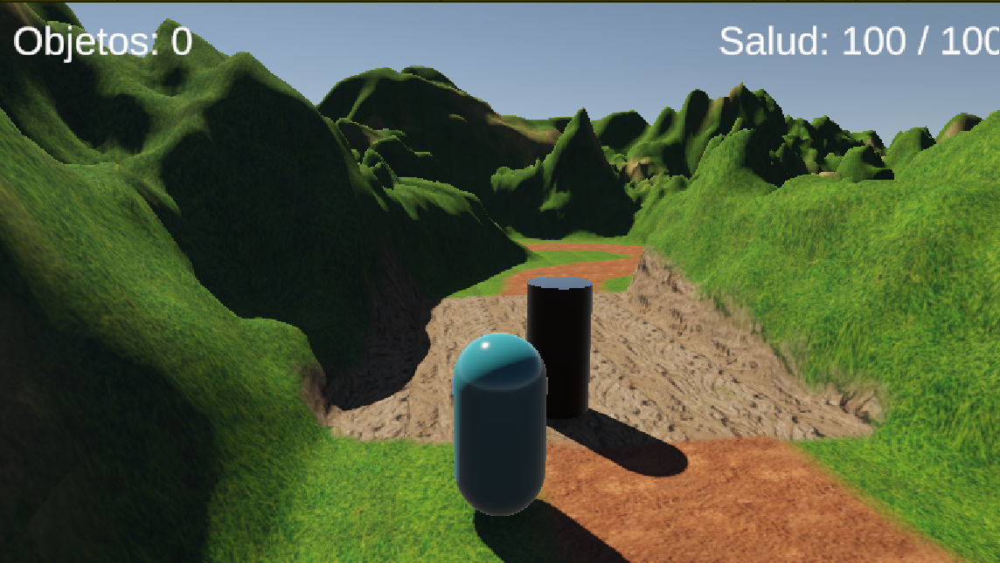
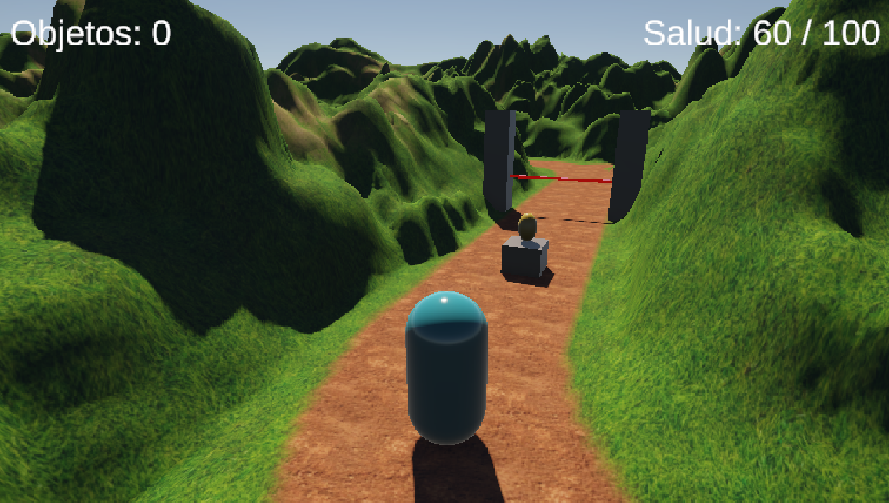
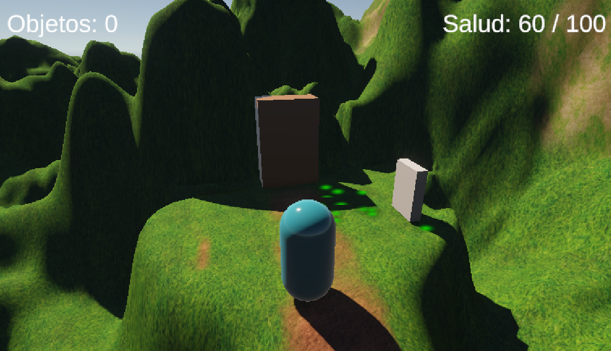

# Metal Gear Solid: Ghost Infiltration

## Datos del desarrollador

- **Nombre y apellido:** Tamara Melisa Quispe
- **LU:** 679
- **Trabajo práctico:** TP2 - PVJ1

## Descripción del juego

*Metal Gear Solid: Ghost Infiltration* es un videojuego desarrollado en Unity. El jugador debe infiltrarse en una instalación militar, evitar 2 centinelas, 
recolectar objetos y superar diferentes peligros para llegar al búnker y completar la misión.

El objetivo es recolectar al menos 7 objetos, activar la consola, abrir la puerta del búnker y alcanzar la zona de victoria sin perder toda la vida.

## Controles

- **W, A, S, D:** movimiento del jugador.
- **Espacio:** saltar.
- **E:** interactuar con objetos, la consola y la puerta.
- **P:** pausar o reanudar el juego.

## Funcionalidades opcionales implementadas

### 1. Zona de gas tóxico

**Script:** `ToxicGasZone.cs`

La zona de gas tóxico inflige daño al jugador mientras permanece dentro de su área. El script detecta al jugador mediante un trigger y utiliza `HealthSystem` para reducir su vida periódicamente.

### 2. Trampa láser

**Script:** `LaserTrap.cs`

La trampa láser detecta cuando el jugador entra en contacto con ella. Al tocarla, le quita toda la vida y provoca el estado Game Over.

### 3. Zona de barro

**Script:** `MudZone.cs`

La zona de barro reduce temporalmente la velocidad de movimiento del jugador al entrar en ella. Al salir, restaura su velocidad normal mediante el script `PlayerMovement`.

## Imágenes del juego

### Imagen 1: Player y enemigo en la zona de barro

### Imagen 2: Laser que mata al jugador

### Imagen 3: Puerta y consola para ganar el juego

